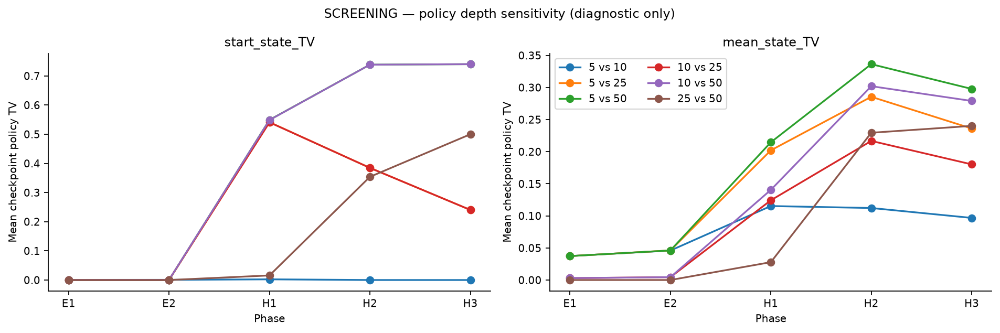
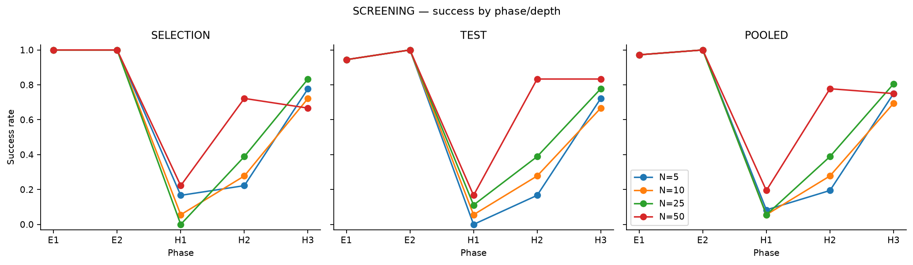
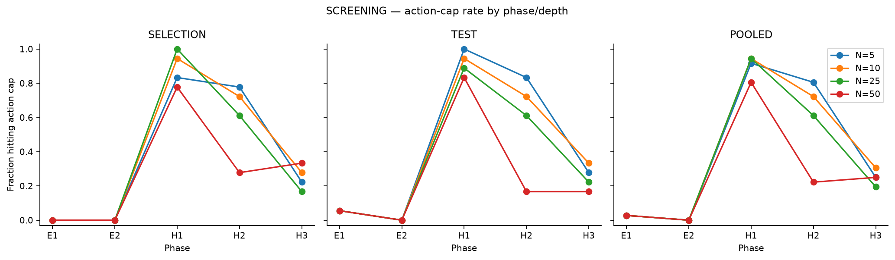
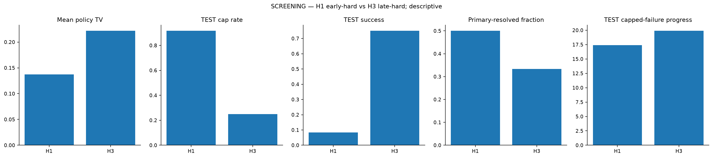

# Adaptive Planning Depth and Meta-Control in Active Inference

A research extension of the mixed Active Inference architecture introduced by **Paul, Isomura & Razi (2024)**, asking a higher-level question:

> **When is additional predictive planning worth computing, and how deep should that planning be?**

This repository is the **companion research repository** for the project. It contains the independent analysis code, curated screening results, figures, and methodological documentation. The original mixed-model implementation is kept in the upstream fork rather than copied wholesale here.

## Scientific basis

This work builds directly on:

**Paul, A., Isomura, T., & Razi, A. (2024). _On Predictive Planning and Counterfactual Learning in Active Inference_. Entropy, 26(6), 484. https://doi.org/10.3390/e26060484**

Original implementation: **`aswinpaul/aimmppcl_2023`**  
Execution fork used for this project: **`SweetiAi/aimmppcl_2023`**

Paul et al. introduced the upstream ingredients used here, including:

- **Dynamic Programming Expected Free Energy (DPEFE)** as the predictive-planning pathway,
- **Counterfactual Learning (CL)** as the experience-based pathway,
- the mixed-model arbitration mechanism,
- the state-dependent arbitration quantity **Beta**,
- the mutating grid-world environment and core implementation.

These are **upstream contributions and are not claimed as contributions of this repository**.

## What this project adds

Paul et al. study how an agent balances predictive planning and experience-based action selection. This project asks a different computational question:

> If the agent can already combine planning and experience, can it also determine **how much fresh planning is worth performing before acting?**

The project therefore shifts from **action arbitration** to **computational arbitration / meta-control**.

The main project-specific contributions are:

- counterfactual interventions on fresh planning depth,
- exact checkpoint-level comparison from matched learned states,
- common-random-number evaluation across planning-depth branches,
- independent selection and TEST rollout streams,
- cost-sensitive value-of-computation analysis,
- policy-sensitivity diagnostics,
- grouped out-of-sample tests of candidate internal meta-control signals,
- explicit negative-result reporting when the tested meta-control signal failed to generalize.

## Experiment A: fresh replanning depth

At each selected pre-planning checkpoint, the learned agent state is held fixed and fresh DPEFE planning is recomputed at:

```text
N ∈ {5, 10, 25, 50}
```

Only the planning-depth intervention changes across counterfactual branches.

Pilot 0 used:

- **2 screening base seeds**,
- **30 checkpoints**,
- **3 selection + 3 TEST rollouts** per depth/checkpoint condition,
- a **15,000-action cap**,
- five learning phases: `E1`, `E2`, `H1`, `H2`, `H3`.

This dataset is explicitly a **screening dataset**, not a confirmatory experiment.

See [`docs/METHODS.md`](docs/METHODS.md) for the experimental logic and [`results/summary/README.md`](results/summary/README.md) for the curated result tables.

## Main screening findings

### 1. Planning depth materially changes policy in the hard regime

Fresh DPEFE policies were nearly invariant across depth in the easy regime but diverged substantially after the environment became hard.



This rules out the trivial explanation that planning depth is merely a computational parameter with no effect on the resulting policy.

### 2. Behavioural consequences of planning depth depend on learning context

Success rates differ across planning depths after the hard transition, particularly during early and intermediate adaptation.



### 3. Hard-regime censoring is substantial

A large fraction of hard-regime rollouts reached the 15,000-action cap, especially at shallower planning depths.



This is a central limitation of the screening study and is why the results are not presented as confirmatory evidence.

### 4. Same-maze early vs late comparison suggests context dependence beyond geometry alone

`H1` and `H3` use the same hard maze but occur at different stages of learning. Their descriptive differences indicate that planning-depth sensitivity changes across learning context even when maze geometry is held fixed.



## Meta-control result: negative for the tested internal-state signals

The project initially asked whether pre-planning internal state could predict when deeper planning was worth its computational cost.

The answer from the current screening study is **no**.

Tested internal representations did not reliably outperform a coarse phase/regime baseline under the strictest grouped out-of-sample evaluation. A richer full-state similarity diagnostic also failed the predefined criterion.

The scientifically supported conclusion is therefore narrower:

> **Planning depth matters and its value is context-dependent, but the current Paul-based agent does not yet provide a reliably accessible internal signal for checkpoint-level planning-depth meta-control.**

This distinction is important:

```text
context-dependent computation ≠ demonstrated metacognitive control
```

## What the results support — and what they do not

The current screening evidence supports:

- planning depth can materially alter the DPEFE policy,
- deeper planning can improve behaviour in some hard-regime conditions,
- the value of deeper planning varies across learning regimes,
- same-maze early/late differences argue against a purely geometric explanation.

The current study does **not** establish:

- that the agent possesses metacognition,
- that it can infer its optimal planning depth from its own internal state,
- that a learned meta-controller generalizes out of sample,
- or that Pilot 0 constitutes confirmatory evidence.

## Repository structure

```text
adaptive-planning-active-inference/
├── analysis/
│   ├── analysis.py
│   ├── policy_sensitivity.py
│   └── plots.py
├── docs/
│   ├── METHODS.md
│   ├── REPOSITORY_ARCHITECTURE.md
│   └── UPSTREAM_AND_SCOPE.md
├── results/
│   ├── figures/
│   └── summary/
├── CITATION.md
├── requirements.txt
└── README.md
```

### `analysis/`

Project-specific held-out analysis, policy-sensitivity metrics, and static plotting utilities. These modules do not implement the original mixed-model agent.

### `results/summary/`

Small curated screening tables only. Raw rollout dumps, serialized checkpoints, local recovery files, and exploratory artifacts are intentionally excluded.

### `results/figures/`

Curated screening figures with explicit interpretation boundaries.

### `docs/`

Methodology, provenance, and the exact boundary between the Paul et al. upstream model and this research extension.

## Reproducibility and execution model

The companion repository contains independent analysis code and curated outputs. Experiments requiring the original mixed-model agent were executed against the official GitHub fork:

**`SweetiAi/aimmppcl_2023`**, forked from **`aswinpaul/aimmppcl_2023`**.

The fork preserves upstream provenance and is the appropriate place for implementation-level reproduction of the original Paul et al. model plus project-specific experiment branches.

For the analysis modules in this repository:

```bash
pip install -r requirements.txt
```

The public-facing repository intentionally does not include large raw outputs or serialized experiment state.

## Project status

**Current status: screening study complete; meta-control hypothesis not supported by the tested internal-state representations.**

The most useful next scientific step is not to rescue the failed predictor by feature search, but to formulate a new task or architecture in which meta-level observables are explicit and can be falsified cheaply before large-scale simulation.

## Attribution

Whenever the mixed model, DPEFE, CL, Beta arbitration, or the original mutating-grid implementation is discussed, please cite:

**Paul, A., Isomura, T., & Razi, A. (2024). _On Predictive Planning and Counterfactual Learning in Active Inference_. Entropy, 26(6), 484. https://doi.org/10.3390/e26060484**

See [`CITATION.md`](CITATION.md) and [`docs/UPSTREAM_AND_SCOPE.md`](docs/UPSTREAM_AND_SCOPE.md) for the detailed attribution boundary.

## Release note

This repository is currently being prepared for public release. The screening results are deliberately presented with conservative interpretation and should not be read as confirmatory statistical evidence.
